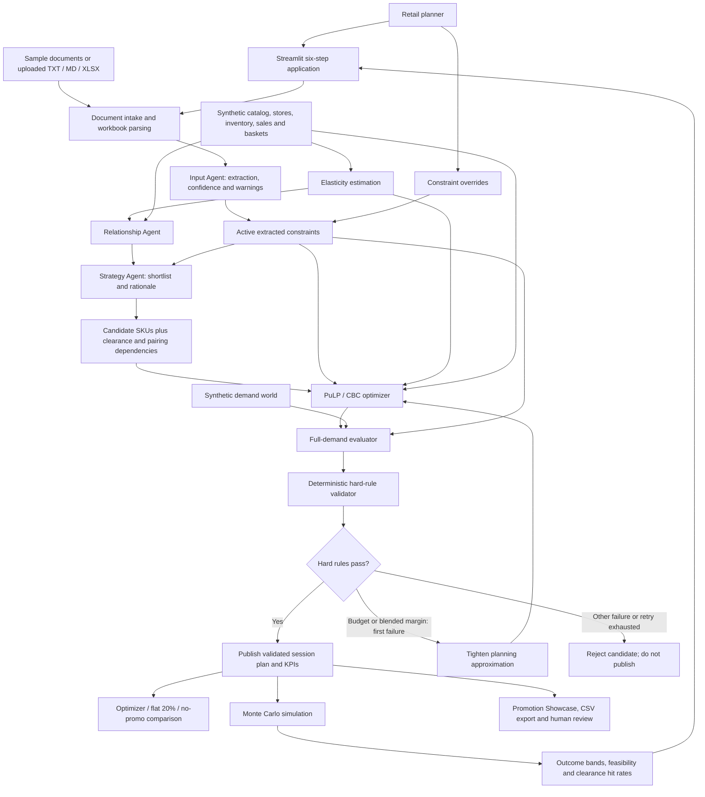
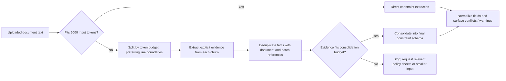

# PromoPilot AI: Architecture

Updated: 2026-10-11. This document describes the implemented prototype, not a proposed production system.

## Purpose and Design Principle

PromoPilot AI turns business documents and a synthetic retail dataset into a promotion plan, evaluates it against policy, and simulates uncertainty before human review.

**LLM plans, solver guarantees:** language models extract and explain; the solver chooses executable percentage-off promotions; deterministic validation gates publication. The guarantee is limited to the represented hard rules under the prototype's deterministic demand evaluation. It is not a guarantee of commercial outcomes or feasibility under every demand scenario.

The application has six Streamlit steps:

1. Input Extraction
2. Plan & Comparison
3. Monte Carlo Simulation
4. Live Re-plan
5. Validator
6. Promotion Showcase

## Component Architecture



The UI coordinates its own cached stages and calls the shared `run_planning()` service. The command-line `Orchestrator` is a separate coordinator using that same planning service; the UI does not instantiate the orchestrator class.

## Components and Ownership

| Component | Implementation | Responsibility |
|---|---|---|
| User workflow | [app.py](../app.py) | Uploads, explicit Run actions, session state, overrides, charts, showcase and export |
| Input Agent | [input_agent.py](../src/agents/input_agent.py) | Documents to constraint JSON, normalization, evidence batching, confidence and warnings |
| Relationship Agent | [relationship_agent.py](../src/agents/relationship_agent.py) | Estimated relationships and basket affinity to substitute/complement groups |
| Strategy Agent | [strategy_agent.py](../src/agents/strategy_agent.py) | Shortlist, suggested mechanisms, discount advice and rationale |
| Shared LLM transport | [_llm.py](../src/agents/_llm.py) | Azure requests, token guards, JSON parsing and optional Ollama fallback |
| Elasticity estimation | [elasticity.py](../src/elasticity.py) | Own/cross demand estimates, baseline forecasts and uncertainty draws |
| Planning service | [optimizer.py](../src/optimizer.py) | Candidate filtering, constrained solve, evaluation, bounded retry and comparison KPIs |
| Evaluation and validation | [evaluator.py](../src/evaluator.py) | Stock-aware KPIs, spending, margins, sell-through and policy checks |
| Demand world | [demand.py](../src/demand.py) | Synthetic demand and cross-product effects used for prototype evaluation |
| Simulation | [simulation.py](../src/simulation.py) | Repeated uncertain-demand evaluations and risk reporting |
| CLI orchestration | [orchestrator.py](../src/agents/orchestrator.py) | Agent dependencies, cumulative constraint patches and cached stage reuse |

## Data and Contracts

**Retail foundation:** CSV tables provide products, stores, inventory, competitor prices, holidays, segments, historical sales and baskets. The synthetic dataset is M5-shaped: 104 weeks, eight stores and 48 SKUs. See [phase1_data_schema.md](phase1_data_schema.md).

**Document intake:** sample business notes or uploaded UTF-8 `.txt` / `.md` files and `.xlsx` workbooks. Each non-empty worksheet becomes a named text table. Uploads are evidence for extraction; they do not replace catalog, inventory or historical-sales tables.

**InputResult:** `constraints`, `confidence`, `warnings`, and the raw model result. Percentage fields are normalized to decimal fractions. The parser is not a complete business-schema validator: malformed or missing model output can still require user correction.

**StrategyResult:** shortlist entries identify SKUs, priority, advisory mechanism, suggested discount and rationale. Clearance SKUs and transitively linked promote-together SKUs remain solver-eligible even if the LLM omitted them. Hard exclusions still apply.

**Executable plan:** a pandas table with `week_start`, `store_id`, `sku`, and `discount_pct`. This represents percentage-off store-SKU-week decisions, not executable BOGO, bundle pricing or segment-specific offers.

**Planning result:** `plan`, `constraints`, `strategy`, solver `status`, `solution_status`, optimizer/baseline KPIs, `violations`, `hard_violations`, `clearance_slack_units`, and `validation_log`.

**SimResult:** KPI sample arrays, per-target sell-through samples, scenario count, hard-rule feasibility rate and violation counts.

The live UI explicitly passes the active extracted or patched constraints to planning, evaluation, simulation and validation. Gold constraints score sample extraction; they do not supply live policy. Standalone benchmark commands retain default gold-constraint loading. Gold demand parameters are used by the synthetic evaluation world, so this is not an out-of-sample validation on real retail data.

## Token-Bounded Extraction



- Upload limits: 1 MB per file and 1 MB combined; expanded workbook contents are limited to 100 MB; extracted text is limited to 500,000 characters.
- Input token estimates use the larger count from `cl100k_base` and `o200k_base`, including a small message overhead allowance.
- Large-upload evidence batches and final consolidation each have a 6,000-input-token budget. The implementation caps processing at 256 batches.
- All source text in a successfully completed batch extraction is submitted across chunks without silent truncation. Model evidence extraction can still omit or misunderstand facts.
- Evidence preserves explicit values, units, dates and supersession/conditional status. Consolidation is instructed to flag unresolved conflicts, not silently select a value.
- Oversized evidence is automatically compacted in token-bounded groups (3,000 input tokens), with at most four reduction rounds before final consolidation. Document sources and distinct numeric values are checked for preservation; conflicts must remain explicit. Non-numeric semantic preservation still depends on model quality and requires review.
- Invalid evidence, changed numeric values, non-shrinking reduction, evidence still oversized after four rounds, or truncated model output stops extraction; partial constraints are not published. There is no persistent batch-resume mechanism.
- Batching makes multiple sequential model calls and may take substantially longer than a small-document request.

## Model Routing

Azure OpenAI is primary, with deployment name `gpt-4o-mini` configured through `AZURE_OPENAI_DEPLOYMENT`. Credentials remain in environment configuration and are not part of the architecture document.

An enabled Ollama fallback uses `hf.co/openbmb/MiniCPM5-2B-GGUF:Q4_K_M`. Eligible Azure API/configuration failures route to the local model; Azure bad requests, including context overflow, are not retried locally. Fallback use is logged. JSON calls request Ollama JSON mode.

The shared Azure guard caps input at 96,000 tokens. Ollama defaults to an 8,192-token context with 2,048 tokens reserved for output; its effective input allowance is 6,144 tokens. Extraction batches fit within that allowance. Other agent requests can still be too large for local fallback.

Local transport targets `http://127.0.0.1:11434`; Docker Desktop defaults to `http://host.docker.internal:11434`. `OLLAMA_BASE_URL`, `OLLAMA_MODEL`, `OLLAMA_CONTEXT_TOKENS` and `OLLAMA_FALLBACK_ENABLED` control this behavior. Ollama must be running with the model installed. Local extraction quality is not assumed equivalent to Azure.

## Optimization and Publication Gate

PuLP models binary decisions for each planning week, store, SKU and discount depth. The default grid is 10%, 15%, 20%, 25%, 30% and 35%. Demand coefficients are precomputed from estimates; the full demand world is evaluated after the solve.

The objective is the implemented promoted-margin/contribution proxy plus `0.10 * revenue_lift`, minus a clearance penalty of $1,000 per slack unit. It is an approximation, not exact global optimization of the nonlinear full-demand net contribution.

| Hard Rules | Soft Outcomes |
|---|---|
| Global, brand and private-label discount caps | Clearance sell-through targets |
| Per-SKU and blended promotional margin floors | Buffered planning shortfalls measured in units |
| Marketing budget | Evaluated target misses reported separately |
| No-promo products and regional blackouts | Monte Carlo clearance hit rates |
| Mutual exclusion and promote-together rules | |
| Consecutive-week and category-count limits | |

The model also blocks target-SKU promotions after its modeled expiry cutoff. Evaluation accounts for finite stock and expiry; the coefficient approximation does not constitute exact inventory optimization.

Live planning gives CBC 15 seconds per attempt. Standalone `optimize()` defaults to 120 seconds. `Optimal` means optimal for the MIP approximation; a time-limited integer incumbent is labeled `Feasible`. No integer solution raises an error rather than rounding failed-solve values into a plan.

After each solve, evaluation and validation use the original active constraints. If budget or blended margin fails on the first attempt, the planning service tightens the approximation and retries once. Other hard failures or a second failure reject the candidate. The service publishes only a hard-rule-valid result; soft clearance misses remain visible. There is no precomputed fallback plan.

## Re-plan and State Lifecycle

```mermaid
sequenceDiagram
    participant User
    participant UI as Streamlit Session
    participant Strategy as Strategy Agent
    participant Planning as Shared Planning Service
    participant Validator as Evaluator and Validator
    User->>UI: Apply budget / margin / discount / consecutive-week overrides
    UI->>Strategy: Patched active constraints and cached relationships
    Strategy-->>UI: Updated shortlist and rationale
    UI->>Planning: Patched constraints and shortlist
    Planning->>Validator: Candidate plan and original patched policy
    opt First budget or blended-margin failure
        Validator-->>Planning: Reject with violations
        Planning->>Planning: Tighten approximation and solve once more
        Planning->>Validator: Re-evaluate against original patched policy
    end
    alt Hard rules pass
        Planning-->>UI: New validated plan, KPIs and retry log
        UI->>UI: Replace active result and invalidate simulation / review flag
        UI-->>User: Before / after comparison and new plan
    else Solve or validation fails
        Planning-->>UI: Error
        UI-->>User: Error; previous validated plan remains active
    end
```

Elasticity and demand resources are process-cached. Agent and simulation results use Streamlit caching; published workflow results live in session state. Navigation and slider changes do not automatically invoke agents or solve plans.

Changing document source/files clears downstream session results. A successful re-plan invalidates simulation and the showcase review flag. Simulation always receives the active plan and its constraints. CLI orchestrator patches accumulate and reuse input/relationship stages; simulation remains a separate explicit operation.

## Simulation and Showcase

Simulation draws uncertain elasticities and applies Poisson demand noise for each scenario. It reports revenue/contribution/spend bands, structural policy feasibility and per-target clearance hit rates for optimizer, flat-20% and no-promo plans. Budget and blended-margin rules are rechecked per scenario. Clearance misses do not count as hard-rule infeasibility.

The simulation implementation does not currently model an explicit competitor-price reaction policy. It temporarily replaces the cached demand model's elasticity arrays and restores them after evaluation; concurrent sessions need isolation or synchronization before production use.

The final showcase uses the current validated plan, not invented dashboard figures. It displays USD synthetic forecasts, solver status, product/discount/week/store summaries, remaining budget, clearance warnings and simulation status. Category photographs are illustrative, not photos of the synthetic SKU brands. CSV download exports the executable plan. The review checkbox is session-only: there is no launch API, durable approval record or execution integration.

## Deployment and Trust Boundaries

- Streamlit runs directly in Python or in the supplied Docker image. Docker Compose exposes the app on port 8501 and mounts the data directory.
- The local development preview on port 8517 is a separate process. Rebuilding Docker does not restart it. Imported agent modules may remain cached across Streamlit reruns; restart the correct process when changing shared modules.
- Uploaded documents can be sent to Azure. Ollama fallback sends them to its configured endpoint. Users must avoid uploading sensitive information without an appropriate data-handling policy.
- Prompt instructions treat documents as data, but prompt-injection resistance is not proven. Deterministic checks enforce represented rules, not the factual correctness of extracted policy.
- The prototype has no authentication, durable audit database, job queue, persistent batch checkpoints or multi-user concurrency guarantees. Streamlit caches are process-level; they are not a hardened tenant-isolation mechanism.
- Production work includes schema validation, complete policy coverage, real demand calibration, concurrency isolation, durable approvals/audit, observability and secure deployment.

## Evidence and Verification

| Claim | Evidence Surface | Boundary |
|---|---|---|
| Unstructured and spreadsheet inputs | Upload-to-extraction tests and batching tests in [test_phase5_ui.py](../tests/test_phase5_ui.py) | Tests mock model semantics; actual documents require review |
| Constraint-driven product selection | Candidate filtering and tight-budget tests in [test_phase2_optimizer.py](../tests/test_phase2_optimizer.py) | LLM shortlist limits the eligible search space |
| Recovery and hard-rule rejection | Validator retry/exhaustion tests and failed-solver tests | Only one deterministic retry; no arbitrary-rule repair |
| Connected dynamic re-plan | UI plan/constraint handoff and cumulative CLI patch tests | Competitor changes are not a live override control |
| Uncertain outcome reporting | [test_phase4_simulation.py](../tests/test_phase4_simulation.py) | Synthetic demand, not guaranteed future performance |
| Final user-facing showcase | Showcase session-plan tests in [test_phase5_ui.py](../tests/test_phase5_ui.py) | Human review only; no launch integration |

Latest recorded UI suite: 29 passed. Latest focused batching/context check after preview restart: 8 passed. A prior affected-workflow run recorded 26 passed, 1 skipped, with four long standalone solver tests deselected; do not describe that as a complete repository test pass. A real local Ollama JSON health request succeeded. The user's actual uploaded workbook has not been validated end to end against live Azure in these checks.

Related implementation notes: [phase2b_optimizer.md](phase2b_optimizer.md), [phase3_agents.md](phase3_agents.md), [phase4_simulation.md](phase4_simulation.md), and [phase5_ui.md](phase5_ui.md).